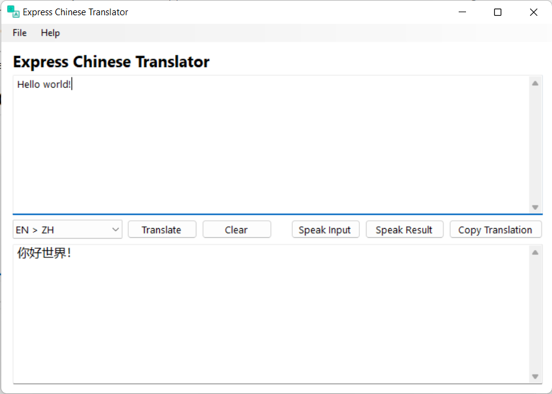

# Express Chinese Translator
  

 A desktop Google Translate client for translating between English and Simplified Chinese.  

 I wrote this app because I needed a desktop translation app for a C programming exam (not C#!), and the translations from the translator included with Sogou Pinyin were inferior compared to the ones by Google, and it lacked a speak button. All the other "translation" desktop apps out there were riddled with malware, Microsoft had discontinued their UWP translator app, and Google only has the translator website, which I couldn't use during the exam, so I decided to write my own translator app, which lacks features, but at least it worked well enough for the exam. Perhaps, next time, I should spend more time studying C for the exam rather than wasting my time making my own translation client in C# with WinForms!
 
 Edit: Google Translate's Chinese version is now discontinued, but you can easily fix this by editing the HOSTS file with the API IP address. Search it up for more details.

 

## 2026 UPDATE - WPF PORT!
For an upcoming potential job, I would have to rewrite a company's WinForms apps in WPF. So, I decided to practice using this old app of mine, and the result was awesome! I used GitHub Copilot and Claude Sonnet 4.5 to vibe-port the UI to WPF, and with a couple of prompts, the UI looks exactly the same as the WinForms original! AI is great these days! Back in the day, converting WinForms to WPF was a tedious task! You had to rewrite the entire UI by hand in XAML. But this is great! I look forward to helping them convert their WinForms apps to WPF! I can't wait to start working for them!
